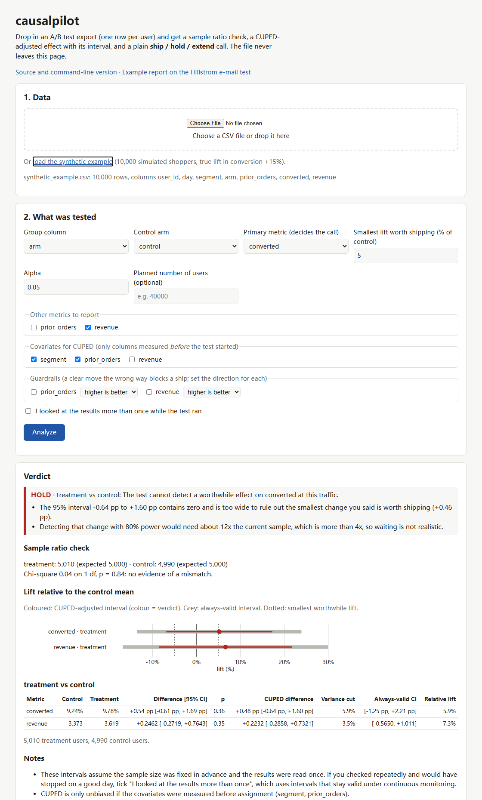
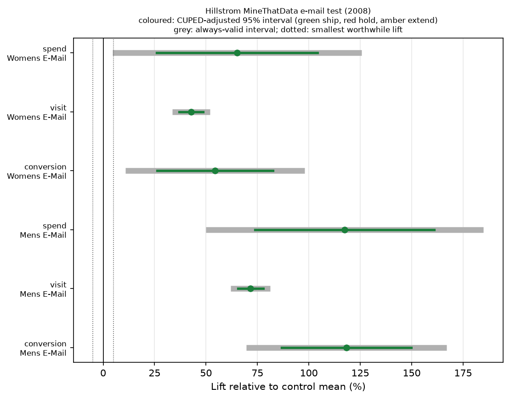

# causalpilot

Reads an A/B test export, checks the traffic split, estimates the effect with CUPED and says whether to **ship, hold or keep the test running**, for analysts and engineers who have per-user test data but no experimentation platform. Give it a CSV with one row per user; it explains every call in plain words, on the command line or [in the browser](https://appleweiping.github.io/causalpilot/).

[Try it in the browser](https://appleweiping.github.io/causalpilot/) (your file stays on your machine) · [Report on a real e-mail experiment](examples/hillstrom/report.md) · [Simulation benchmark](benchmark/results.md)

```text
$ causalpilot simulate test.csv
Wrote 60,000 rows to test.csv (true lift +8.0%, synthetic data)
$ causalpilot analyze test.csv --group arm --control control --metric converted --metric revenue --covariate prior_orders --min-lift 0.02
test.csv: 60,000 rows, control = control
Sample ratio: treatment: 29,940, control: 30,060  (chi-square 0.24, p = 0.624)  OK

treatment vs control
  converted           8.95% -> 9.36%      CUPED +0.47 pp [+0.02 pp, +0.92 pp]  p = 0.0403  (+4.6%)
  revenue             3.217 -> 3.388      CUPED +0.1912 [-0.008097, +0.3905]  p = 0.0601  (+5.3%)
  -> SHIP: converted improves, though the size is uncertain.
     The 95% interval +0.02 pp to +0.92 pp excludes zero; the point estimate is +0.47 pp.
     The low end is below the smallest change you said is worth shipping (+0.18 pp), so a repeat with more traffic would pin the size down.

Note: These intervals assume the sample size was fixed in advance and the results were read once. If you checked repeatedly and would have stopped on a good day, rerun with --peeking, which uses intervals that stay valid under continuous monitoring.
Note: CUPED is only unbiased if the covariates were measured before assignment (prior_orders).
```

Run the same file with `--peeking` (because, honestly, you looked every morning) and the call changes:

```text
  -> HOLD: The test cannot detect a worthwhile effect on converted at this traffic.
     The always-valid 95% interval -0.22 pp to +1.16 pp contains zero and is too wide to rule out the smallest change you said is worth shipping (+0.18 pp).
     Detecting that change with 80% power would need about 13x the current sample, which is beyond the --max-extend limit.
```



## Why I built it

Most A/B tests I have seen analysed were a `t.test` and a screenshot. The p-value was the least of the problems: arms that were not the size they should be, results read every day until they looked good, and nobody writing down beforehand what lift would be worth shipping. causalpilot does the boring checks in a fixed order and refuses to call a winner when the data cannot support one.

## Install

```bash
pip install git+https://github.com/appleweiping/causalpilot
```

Python 3.10 or newer; it depends on NumPy, pandas and Matplotlib. The browser version needs nothing: open the [demo page](https://appleweiping.github.io/causalpilot/) and drop in a CSV.

## Using it on your own export

The CSV needs one row per randomized user, a column naming the arm, and one or more outcome columns (0/1 or numbers). Columns measured *before* the test started (past orders, country, platform) can be passed as covariates.

```bash
causalpilot analyze export.csv \
  --group variant --control A \
  --metric purchased --metric revenue \
  --covariate orders_last_90d --covariate country \
  --guardrail refunded:lower \
  --min-lift 0.02 --split 50:50 \
  --out report/
```

- The first `--metric` decides the call; the others are reported alongside it.
- `--guardrail` metrics must not get clearly worse. Higher counts as better unless you add `:lower`, so write `refunded:lower` for refunds, cancellations, errors or anything else where a rise is bad. The browser version has a direction menu next to each guardrail.
- `--min-lift` is the smallest relative lift worth shipping (0.02 = 2% of the control mean; default 1%).
- `--split` is the planned split, control first (default: equal).
- `--out` writes `report.md`, `report.json` and `effects.png`; `--json` prints everything the report is built from.
- Add `--peeking` if you looked at the results more than once while the test ran, and `--planned-n` with the sample size you planned, if you had one.

## Real data: the Hillstrom e-mail test

In 2008 Kevin Hillstrom published an experiment on 64,000 customers of an online retailer for the [MineThatData E-Mail Analytics challenge](https://blog.minethatdata.com/2008/03/minethatdata-e-mail-analytics-and-data.html). A third got an e-mail featuring men's merchandise, a third one featuring women's merchandise, and a third no e-mail; visits, conversions and spend were tracked for two weeks.

```bash
causalpilot hillstrom --out examples/hillstrom
```

downloads the CSV from the author's site (over plain HTTP, since the site's certificate did not validate for me, so the file is checked against a pinned SHA-256), uses past-year spend, recency, past purchase categories, zip-code type and channel as CUPED covariates, and treats a 5% lift in spend per customer as the smallest change worth an e-mail campaign. The [full report](examples/hillstrom/report.md) is checked in:

| vs. no e-mail | Spend per customer | 95% interval | Visit rate | Call |
| --- | ---: | ---: | ---: | --- |
| Womens e-mail | +$0.42 (+65%) | +$0.17 to +$0.68 | +4.5 pp | SHIP |
| Mens e-mail | +$0.77 (+118%) | +$0.48 to +$1.05 | +7.6 pp | SHIP |



The sample ratio check passes (21,387 / 21,306 / 21,307, p = 0.90). Two things I found worth noting:

- **CUPED barely helps here.** Two-week spend is zero for 99% of customers and past-year spend hardly predicts it, so the adjustment cut variance by 0.1% for spend and about 3% for visits. It helps more when the metric has a close pre-period twin (the same metric measured before the test).
- **Mens vs. Womens is not settled.** Comparing the two e-mails directly gives +$0.35 per customer, 95% interval +$0.03 to +$0.66: a SHIP with an uncertain size. With `--peeking` the always-valid interval is -$0.14 to +$0.83 and the call becomes HOLD. If the analyst had been watching the numbers come in, that win would not be safe to claim.

```bash
causalpilot analyze ~/.cache/causalpilot/hillstrom_2008.csv --group segment \
  --control "Womens E-Mail" --treatment "Mens E-Mail" \
  --metric spend --covariate history --covariate recency --min-lift 0.05 [--peeking]
```

The data is not redistributed in this repository.

## What it checks, in order

1. **Sample ratio mismatch.** A chi-square test of the arm sizes against the planned split. Below p = 0.001 the verdict is HOLD regardless of the metrics, because a broken split usually means lost or duplicated users, and that biases everything downstream.
2. **The effect.** Treatment minus control with a Welch standard error and a normal-approximation interval, plus the relative lift with a delta-method interval.
3. **CUPED** ([Deng et al., 2013](https://exp-platform.com/Documents/2013-02-CUPED-ImprovingSensitivityOfControlledExperiments.pdf)). Each user's metric minus the part predicted by the pre-experiment covariates (pooled least squares; text columns are one-hot encoded). The estimate stays unbiased because the covariates were fixed before assignment; the interval gets narrower by however much variance the covariates explain.
4. **Peeking.** Fixed-horizon intervals are only valid if you look once. The always-valid interval is the asymptotic confidence sequence from [Waudby-Smith et al. (2021)](https://arxiv.org/abs/2103.06476), applied to the difference in means. It is wider, but you may look as often as you like.
5. **Guardrails.** A guardrail whose interval lies entirely on the wrong side of zero blocks a ship: below zero for a metric where higher is better, above zero for one marked `:lower` (refunds went up).
6. **The call**, following the practical-significance table in Kohavi, Tang and Xu, *Trustworthy Online Controlled Experiments* (2020), ch. 2:

| Interval of the primary metric | Call |
| --- | --- |
| entirely below zero | HOLD (it hurts) |
| above zero and reaching the minimum worthwhile lift | SHIP |
| above zero but entirely below the minimum worthwhile lift | HOLD (real but too small) |
| contains zero, but rules out ± the minimum worthwhile lift | HOLD (no meaningful effect) |
| contains zero and is too wide, more data could settle it (≤ 4x the current sample for 80% power) | EXTEND |
| contains zero and would need more than 4x the data | HOLD (cannot be detected at this traffic) |

Before `--planned-n` is reached, an inconclusive interval is always EXTEND.

## Simulation benchmark

To check the rules do what they claim, `benchmark/run_benchmark.py` simulates 200 experiments in each of five scenarios with a known true effect (40,000 users over 14 days; the smallest worthwhile lift is 10%, which that sample detects with roughly 90% power). The simulated shoppers come from four segments that react differently to the change, one of them negatively. Selected rows from [the full results](benchmark/results.md):

| Scenario | Rule | Shipped | Mean days |
| --- | --- | ---: | ---: |
| no effect | p < 0.05, one look on day 14 | 1.5% | 14.0 |
| no effect | p < 0.05, checked daily, stop when significant | 11.0% | 13.0 |
| no effect | causalpilot `--peeking`, checked daily | 0.5% | 13.8 |
| no effect, 8% of bouncing treatment users not logged | p < 0.05, one look | 66.0% | 14.0 |
| no effect, 8% of bouncing treatment users not logged | causalpilot, one look | 0.0% | 14.0 |
| worthwhile (+15%) | p < 0.05, one look | 100.0% | 14.0 |
| worthwhile (+15%) | causalpilot `--peeking`, checked daily | 95.5% | 7.3 |

Daily peeking at p-values ships a change that does nothing about one time in nine; the always-valid interval keeps that near zero and still finds the real win, usually in half the time. The logging bug fools a plain significance test two times out of three. The sample ratio check catches it every time with one look, and in 99% of runs with daily checks; the other 1% shipped on an early day, before the missing users added up to a detectable mismatch. The price is visible in the full table: with daily checks and no effect, 84% of tests end in EXTEND because the always-valid interval is too wide to rule out a 10% lift by day 14.

Reproduce with `python benchmark/run_benchmark.py` (about 10 minutes on one core; `--runs 20` for a quick check).

## Limits

- One row per randomized unit. Ratio metrics such as click-through per page view, where the analysis unit differs from the randomization unit, need the delta method, which is not implemented.
- Intervals rely on the normal approximation. The tool warns when a 0/1 metric has fewer than 10 events in an arm, but very skewed revenue with a few huge orders can still be misleading at small sample sizes.
- Several treatments or metrics are not corrected for multiple comparisons; the report suggests a Bonferroni alpha when there is more than one treatment.
- The minimum worthwhile lift is a business judgement. The calls are only as good as that number, so pick it before you look at the results.
- CUPED with a covariate measured after assignment (or affected by the treatment) biases the effect. The tool cannot check this for you.
- No segment-level (heterogeneous) effects and no Bayesian analysis.

## Why not something else?

- **GrowthBook, Eppo, Statsig, Optimizely**: full experimentation platforms that do all of this and much more, inside their own data pipeline. If you have one, use it. causalpilot is for an export from somewhere else, a second opinion, or seeing how the pieces fit together in about 1,100 lines of Python.
- **`scipy.stats.ttest_ind`**: gives you a p-value. It does not check the split, reduce variance, deal with peeking or turn the numbers into a decision.

## Development

```bash
pip install -e ".[test]"
python -m pytest                      # Python tests
node --test web/test/parity.test.mjs  # the browser code gives the same numbers as Python
```

The browser version in `web/` is a port of the Python code; `web/test/make_expected.py` regenerates the numbers it is checked against.

The first version of this repository (up to commit `2ceff2b`) was a simulated "experimentation agent" with a 3D control room and rule-based stand-ins for language-model baselines. I rebuilt it around the part that was actually useful, the statistics, and kept its simulator for the benchmark.

## License

MIT, see [LICENSE](LICENSE).
