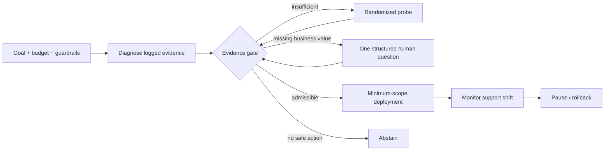
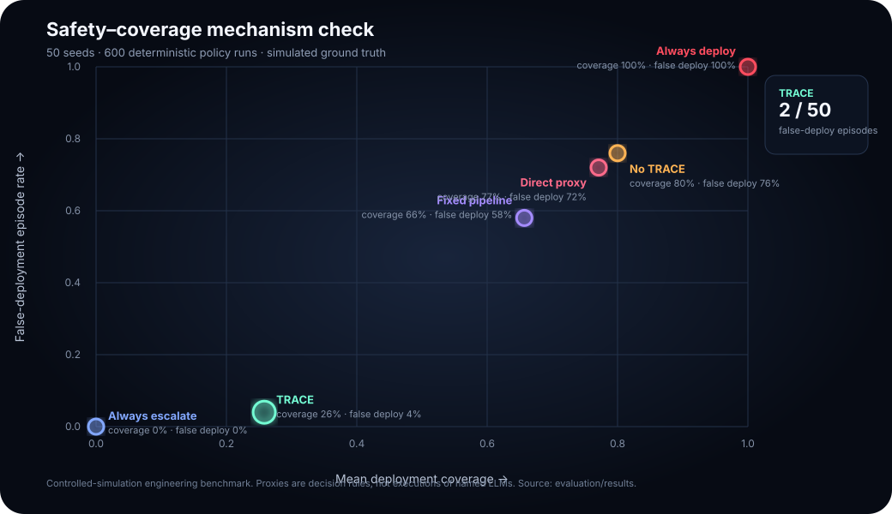

# CausalPilot

[](https://github.com/appleweiping/causalpilot/actions/workflows/ci.yml)
[](https://appleweiping.github.io/causalpilot/)
[](LICENSE)
[](docs/generated_results.md)

**An evidence-gated agent for business experimentation.** CausalPilot decides when to diagnose, buy randomized evidence, ask a human, deploy one segment, pause, roll back, or abstain. The language layer may propose an action; deterministic gates own action rights.

[Live 90-second control room](https://appleweiping.github.io/causalpilot/) · [90-second MP4](docs/assets/causalpilot-demo.mp4) · [Technical report](paper/causalpilot.pdf) · [中文说明](README.zh-CN.md) · [Research landscape](docs/research_landscape.md)


## The research question

> Under limited experiment and human-attention budgets, what evidence should an agent need before it is allowed to act?

TRACE—**Trajectory Risk and Action Control for Experimentation**—maintains four separate risk indices (model, causal, data, and environment), calls deterministic statistical tools, and enforces an explicit state machine. The indices are control signals, not calibrated probabilities.



## Why this is not another agent wrapper

- **Proposal and execution are different authorities.** No model output can bypass state, evidence, risk, budget, diversity, or business-constraint gates.
- **Uncertainty changes the next action.** The system can spend exposure budget, request one material constraint, narrow scope, or refuse to deploy.
- **Truth is scorer-only.** Benchmark policies receive observations; hidden potential outcomes are isolated in a separate scoring object.
- **Claims are executable.** A fixed 50-seed artifact, raw per-episode decisions, intervals, fixture/config fingerprints, and generated paper/chart values are checked in.
- **The 3D view is semantic.** Cluster size is segment share, color is effect/risk, halo is uncertainty, particles are simulated traffic, and every hosted value is visibly labeled as simulation.

Read the full design note: [Why CausalPilot is not an agent wrapper](docs/why_not_an_agent_wrapper.md).

## Checked-in result

This is a **controlled-simulation engineering benchmark**, not a causal research conclusion or live business-lift claim. It pairs 12 deterministic policies over seeds 0–49 (600 runs). Named “LLM” baselines are explicitly decision-rule proxies; no model API was called.

| Policy | False-deployment episodes | Mean coverage | Simulator regret |
| --- | ---: | ---: | ---: |
| TRACE | **4%** (Wilson 95% CI 1.1%–13.5%) | 26% | 0.0065 |
| No TRACE | 76% | 80% | 0.0031 |
| Fixed causal pipeline | 58% | 66% | 0.0042 |
| Always deploy | 100% | 100% | 0.0099 |

TRACE trades coverage and value for safety, so these point estimates do **not** prove superiority at matched coverage. The two observed TRACE false-deployment episodes are retained as failure cases rather than hidden.



[Generated summary](docs/generated_results.md) · [All 12 methods](evaluation/results/RESULTS.md) · [Raw runs](evaluation/results/runs.csv) · [Claim boundaries](docs/claims_we_do_not_make.md)

## Run it

### One command with Docker

```bash
docker compose up --build
```

Open `http://localhost:3000`. The API and interactive OpenAPI docs run at `http://localhost:8000` and `http://localhost:8000/docs`.

### Local development

Requirements: Python 3.11+ and Node.js 20.9+.

```bash
python -m venv .venv
# Windows: .venv\Scripts\activate
# macOS/Linux: source .venv/bin/activate
python -m pip install -e "./backend[test]"
cd frontend && npm ci && cd ..
```

Then run `scripts/run_demo.ps1` on Windows or `scripts/run_demo.sh` on macOS/Linux. The hosted Pages build uses an explicitly labeled, deterministic browser replay; the local build connects to the real FastAPI state machine.

### Reproduce the benchmark

```bash
python evaluation/run_benchmark.py
python scripts/generate_result_assets.py
python -m pytest backend/tests evaluation/tests
```

CI reruns the canonical seeds and fails if the four result artifacts change byte-for-byte. Use the explicit smoke command in [the benchmark guide](docs/how-to-run-benchmark.md) for quick iteration.

## Evidence contract

Every API snapshot exports:

- `evidence_mode=simulated_scm`;
- fixture, dataset, split, seed, estimator, and assumptions;
- fixture and configuration fingerprints;
- `metric_basis` clarifying that runtime business metrics are estimates, not oracle truth.

The runtime audit is an append-only, in-memory transition trace. It is inspectable but is not presented as a cryptographic ledger, durable event store, or complete replay proof.

## Repository map

| Path | Purpose |
| --- | --- |
| [`backend/`](backend/) | FastAPI contracts, state machine, shared TRACE gate, seeded scenario, and deterministic statistics |
| [`frontend/`](frontend/) | Next.js 16 + React Three Fiber control room with reduced-motion and static replay modes |
| [`evaluation/`](evaluation/) | Truth-isolated benchmark, 12 policies/ablations, adapters, raw and summary artifacts |
| [`paper/`](paper/) | Four-page report; numeric macros are generated from the canonical CSV |
| [`docs/`](docs/) | Research, architecture, API, data card, limitations, application kit, and 90-second script |

Start with the [documentation index](docs/README.md), [architecture](docs/architecture.md), [data card](docs/data-card.md), and [limitations](docs/limitations.md).

## Scope and next research steps

The current artifact validates executable gates in a synthetic scenario. It does not yet establish matched-coverage superiority, probability calibration, real LLM planning quality, or live causal lift. The strongest next steps are preregistered scenario families, real-model executions under fixed budgets, held-out unsafe-action calibration, corrected Criteo/OBD estimator validation, and shadow-mode enterprise deployment.

If you use the project, cite [`CITATION.cff`](CITATION.cff). Contributions and responsible disclosure are covered by [`CONTRIBUTING.md`](CONTRIBUTING.md) and [`SECURITY.md`](SECURITY.md).
