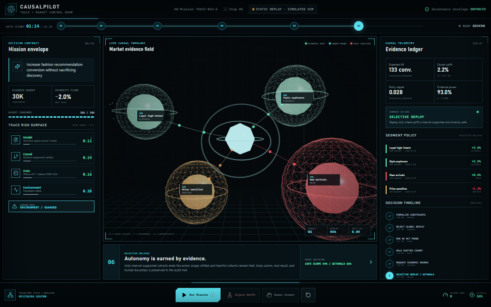

# CausalPilot：用证据分配 Agent 行动权

[在线 90 秒控制室](https://appleweiping.github.io/causalpilot/) · [90 秒 MP4](docs/assets/causalpilot-demo.mp4) · [4 页技术报告](paper/causalpilot.pdf) · [研究调研](docs/research_landscape.md) · [申请材料包](docs/application_kit.zh-CN.md)



CausalPilot 研究的不是“Agent 能不能生成建议”，而是一个更可证伪的问题：

> 在实验曝光和人类注意力有限时，Agent 需要什么证据，才有资格实验、询问、分群部署、暂停、回滚或拒绝行动？

核心方法 TRACE 指 **Trajectory Risk and Action Control for Experimentation**。它维护模型、因果、数据、环境四类风险指数，并把统计计算和最终提交权交给确定性代码。风险指数是工程控制信号，不是假装已经校准的概率。

## Demo 有什么

- 语义化 3D 用户群：大小对应人群占比，颜色对应效果/风险，光晕对应不确定性，粒子对应模拟流量；
- 历史相关性不足时，拒绝全量上线并购买 9,000 次随机探针曝光；
- 漂移注入后隔离受影响分群，不把未部署分群伪装成“已暂停”；
- 缺少业务约束时，只问一个结构化、能进入硬门控的问题；
- 8 个动作、显式状态机、并发预算锁和 append-only 内存轨迹；
- API、fixture、config、split、estimator、assumptions 与证据模式全部显式导出。

托管版始终标记为 `STATIC REPLAY · SIMULATED SCM`；本地版连接真实 FastAPI 状态机。两者都不会冒充线上实验或远程模型。

## 结果怎么读

当前证据是 **50 个固定 seed、12 个确定性策略、600 次运行的受控模拟工程基准**，不是产业提升结论，也没有调用 LLM API。

| 策略 | 错误部署 episode | 平均覆盖率 | 模拟器 regret |
| --- | ---: | ---: | ---: |
| TRACE | **4%**（Wilson 95% CI 1.1%–13.5%） | 26% | 0.0065 |
| 无 TRACE | 76% | 80% | 0.0031 |
| 固定因果流水线 | 58% | 66% | 0.0042 |
| 永远部署 | 100% | 100% | 0.0099 |

TRACE 明显牺牲了覆盖率，因此不能据此声称“同覆盖率下更优”。实际出现的 2 个错误部署 episode 被完整保留，这正是项目可信度的一部分。

[生成结果摘要](docs/generated_results.md) · [12 个方法完整结果](evaluation/results/RESULTS.md) · [原始逐 seed 记录](evaluation/results/runs.csv) · [我们不声称什么](docs/claims_we_do_not_make.md)

## 为什么不是普通 Agent Wrapper

1. LLM 只能提出动作，不能绕过证据、风险、预算、多样性和业务约束门。
2. 不确定性会改变下一步：补数据、做随机探针、问人、缩小部署范围或 abstain。
3. benchmark 的策略观察与隐藏真值分离；真值只进入 scorer。
4. 结果、论文数字和图表都从同一 canonical CSV 生成并由 CI 重跑。
5. 失败案例、证据边界和模拟假设都放在仓库首页，而不是藏在脚注里。

## 一键运行

```bash
docker compose up --build
```

浏览器打开 `http://localhost:3000`，API 文档位于 `http://localhost:8000/docs`。

本地开发、benchmark 复现、API 使用和数据限制请从 [文档索引](docs/README.md) 开始。演示录制按 [90 秒逐镜脚本](docs/demo_script.zh-CN.md) 执行；求职包装、自荐信主线和面试问答见 [申请材料包](docs/application_kit.zh-CN.md)。

## 诚实边界

当前项目证明的是：一套证据门控机制能够被执行、测试、审计并显式失败。它尚未证明真实 LLM 规划能力、概率校准、matched-coverage 优势、真实企业收益或线上因果增量。下一步应把风险校准、真实模型轨迹、公开随机数据验证和企业 shadow mode 做成预注册实验。
