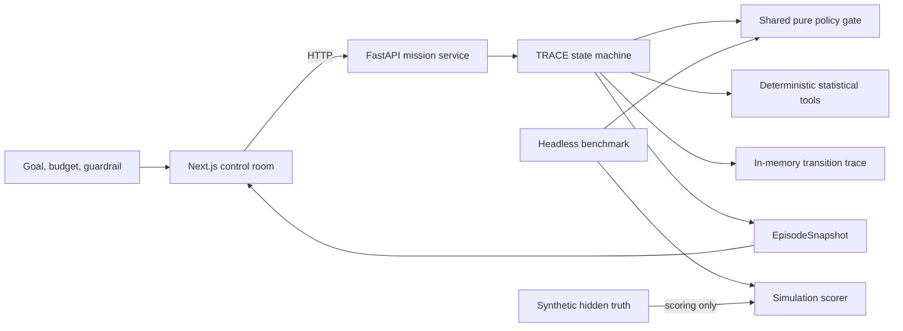

# Architecture

CausalPilot separates language-level proposals from deterministic action rights.
The same mission contract drives the local API, the control-room visualization,
and the headless policy benchmark.

## Three execution modes

| Mode | Decision source | Purpose | External action |
| --- | --- | --- | --- |
| Local full stack | FastAPI mission runtime | Inspect real state transitions and API contracts | None |
| Static demo | Seeded browser simulator | Host the visual narrative without a server | None |
| Headless benchmark | Shared deterministic policy interface | Compare policies across predeclared simulator seeds | None |

The UI labels whether a snapshot came from the API or the browser simulator. A
network failure may trigger the simulator fallback, so visual success alone does
not prove that the API ran.

## Mission runtime

Each mission owns its configuration, seeded random generator, experiment budget,
risk profile, segment views, decision, and audit events. The runtime returns an
`EpisodeSnapshot` after every accepted action. The snapshot includes
`allowed_actions`; clients should treat this field as the authoritative action
menu for the current state.

The service keeps missions in memory. Reset creates a new mission with a parent
reference instead of rewriting the previous audit trail.

Each snapshot declares `evidence_mode`, fixture/dataset version, split, seed,
estimator, assumptions, and fixture/config fingerprints. Runtime business
metrics include a `metric_basis` and do not use hidden potential-outcome truth.

## TRACE decision boundary

The runtime tracks four risk indices:

- **model** — plan and tool-selection risk;
- **causal** — identification and effect-evidence risk;
- **data** — sample, balance, overlap, and precision risk;
- **environment** — shift and tool-environment risk.

Statistical tools compute observable evidence. A unified action validator checks
the state, budget, human constraints, segment target, and risk gates before a
commit action. A rationale cannot bypass a failed gate.

The indices are control signals, not calibrated probabilities, unless a
separate reliability artifact establishes that interpretation.

## State and action model

The public action vocabulary is:

`diagnose`, `experiment`, `ask_human`, `segment_deploy`, `deploy_all`,
`pause_segment`, `rollback`, and `abstain`.

The state vocabulary is:

`diagnosing`, `experimenting`, `awaiting_human`, `ready_to_deploy`, `deployed`,
`drift_detected`, `rolled_back`, and `abstained`.

Transitions are enforced in the backend. A disallowed or incomplete transition
returns HTTP 409 and leaves the mission unchanged.

## Evidence and audit flow

Every accepted operation appends an event with a sequence number, timestamp,
state transition, action, and details. The snapshot carries the complete audit
available to the in-memory mission. The server-sent events endpoint replays this
audit and then closes; it is a catch-up stream, not a durable event bus.

This trace supports inspection of state and action order. It is not a
cryptographic ledger, durable replay log, or proof that every evidence dependency
can be reconstructed.

Benchmark policies receive observable mission evidence. Hidden potential outcomes
and scenario labels remain in the scorer. Metrics derived from hidden simulator
truth carry a `_gt` suffix.

## Repository map

| Path | Responsibility |
| --- | --- |
| `backend/causalpilot/` | API, state machine, statistical tools, and mission store |
| `backend/tests/` | Runtime, transition, concurrency, and tool tests |
| `evaluation/` | Simulator, policies, adapters, metric definitions, and artifacts |
| `frontend/` | Interactive control room and seeded offline story |
| `paper/` | Technical report source and rendered PDF |
| `docs/` | Research, product, operational, and application documentation |
| `scripts/` | Setup, local launch, and generated-result helpers |

## Trust boundaries

- Browser input is untrusted and validated by strict Pydantic request models.
- The local HTTP API is unauthenticated and must not face an untrusted network.
- Optional datasets and model adapters are outside the default trusted path.
- Docker processes run without root privileges and with read-only filesystems,
  but the application still lacks production isolation and policy enforcement.

See [Limitations and failure modes](limitations.md) before extending the system.
