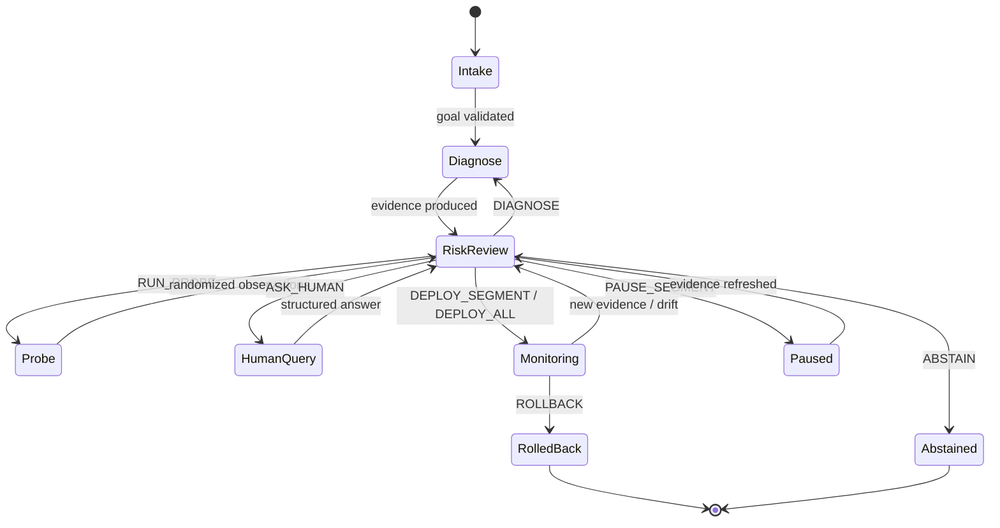
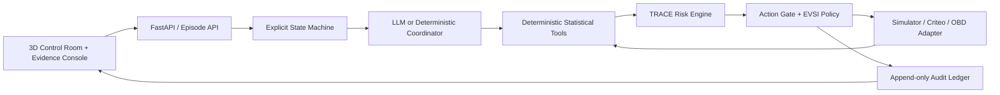

# CausalPilot / TRACE 产品与研究规格

> 状态：**FROZEN FOR APPLICATION MVP**
> 版本：v0.1
> 冻结日期：2026-07-19
> 规格原则：所有“效果”都必须由当前运行或保存的评测 artifact 计算；没有结果时显示 `Not evaluated`，不得用占位数字包装成成果。

## 1. 产品定义

### 1.1 名称

- **产品名：CausalPilot**
- **方法名：TRACE — Trajectory-calibrated Risk-aware Agentic Causal Experimentation**
- **一句话：** An evidence-gated experimentation agent that earns deployment authority by reducing risk—not by verbalizing confidence.

### 1.2 目标用户

- 需要在有限流量下做推荐、广告、营销或产品实验的增长/产品负责人；
- 需要检查识别、overlap、功效、异质性与 guardrail 的数据科学家；
- 需要审计“Agent 为什么实验、询问、部署或拒绝”的业务/风险负责人；
- 本项目的直接受众是评审者：他们应在 90 秒内看懂研究问题，在 5 分钟内验证系统不是普通 Agent wrapper。

### 1.3 核心 Jobs-to-be-Done

用户给出一个业务目标、风险约束和预算后，系统需要：

1. 把目标解析成 outcome、guardrail、预算、可行动作与待澄清约束；
2. 调用确定性统计工具收集证据；
3. 沿轨迹更新模型、因果、数据、环境四类风险；
4. 在诊断、探针、人类询问、分群部署、全量部署、暂停、回滚、拒绝之间选择下一步；
5. 对每次选择输出可复核证据和审计事件；
6. 将模拟结果、公开 RCT 离线估计和 logged-bandit OPE 明确区分。

## 2. 非目标

首版明确不做：

- 不连接真实企业投放系统，不声称运行线上 RCT；
- 不自动发送广告、调整真实推荐流量或触发不可逆外部动作；
- 不做通用 causal discovery，也不替代领域专家定义 DAG/识别假设；
- 不把 LLM persona 模拟当作真实消费者实验；
- 不声称任何真实利润、收入或转化提升；
- 不声称“世界首个”或“产业级可靠”，除非后续系统综述和真实部署支持；
- 不展示或保存模型私有 chain-of-thought；审计保存的是输入、工具、结构化证据、行动、reason code 和简短 rationale。

## 3. 冻结的研究问题

### 3.1 主问题

> 在实验曝光预算 `B_exp` 和人类问题预算 `B_human` 有限时，TRACE 能否在匹配部署覆盖率下减少 ground-truth harmful deployment，并在匹配风险上限下提高策略价值，同时减少不必要实验和人工介入？

### 3.2 可证伪假设

- **H1 — Selective autonomy：** TRACE 在相同 deployment coverage 下具有更低的 `harmful_deployment_rate_gt`；若不成立，则风险门没有产生预期价值。
- **H2 — Information action：** TRACE 的 probe/human query 在相同 regret 下消耗更少的曝光和人工问题；若不成立，VOI 机制应被简化为静态规则。
- **H3 — Trajectory risk：** 使用历史工具失败、冲突证据与漂移的轨迹风险，比 verbalized confidence 更好地预测 unsafe action；若不成立，不应声称“trajectory-calibrated”优于单步分数。
- **H4 — Component necessity：** 去除动态校准、实验动作、人类询问或 VOI 至少应让一项主指标显著退化；否则对应组件不是必要贡献。

### 3.3 研究单位

一个 **episode** 是一次从业务目标到终止动作的完整决策轨迹。最小 episode 包含：

```text
goal + constraints + evidence_mode + initial_data + budgets
→ observation/tool/action events
→ optional drift and human response
→ terminal deploy / rollback / abstain
→ deterministic outcome labels where identifiable
```

## 4. 证据模式与数据契约

### 4.1 三种模式

| `evidence_mode` | 默认徽标 | 用途 | 是否有 ground truth |
|---|---|---|---|
| `simulated_scm` | `SIMULATED GROUND TRUTH` | 主 Demo、动作策略、精确 regret/harm 标签 | 是，仅对该生成过程 |
| `criteo_rct_offline` | `PUBLIC RCT — OFFLINE` | uplift/CATE、分群、区间和离线政策评估 | 只有随机处理和观察 outcome；无个体反事实真值 |
| `open_bandit_ope` | `LOGGED BANDIT — OPE` | propensity、支持度、OPE 和 policy/time drift | 有在策略 outcome；目标策略价值是估计量 |

前端和报告禁止隐藏徽标。所有导出结果必须包含 `evidence_mode`、dataset version、split、seed、estimator 和 assumptions。

### 4.2 默认数据版本

- Criteo 默认使用官方 erratum 后的 unbiased 版本（13,979,592 行），不使用有 advertiser leak 的 25,309,483 行版本做主结果；
- Open Bandit 默认用官方 small sample 做 smoke test，完整数据由用户从 ZOZO 下载；
- 两个完整数据集均不提交进 Git；Criteo 按 CC BY-NC-SA 4.0 处理；OBD 在明确数据许可前不重新分发；
- Demo 自有模拟 fixture 可提交，但其每个数字都必须能从固定 seed 重算。

### 4.3 Evidence 结构

```json
{
  "evidence_id": "ev_...",
  "episode_id": "ep_...",
  "step": 3,
  "mode": "simulated_scm",
  "tool": "overlap_check",
  "input_hash": "sha256:...",
  "dataset_version": "demo-fashion-v1",
  "estimate": 0.0,
  "interval": {"level": 0.95, "low": 0.0, "high": 0.0},
  "diagnostics": {},
  "assumptions": [],
  "valid": true,
  "reason_codes": [],
  "created_at": "ISO-8601"
}
```

字段可为空但不能伪造；没有区间时 `interval=null`，不能用 `[estimate, estimate]` 冒充确定性。

## 5. TRACE 四类风险

### 5.1 总体语义

每个 step 维护风险向量：

```text
R_t = (R_model, R_causal, R_data, R_environment)
R_overall = max(R_t)
```

`max` 是首版的保守、可解释聚合，不是经实验证明的最优组合。每个分量位于 `[0,1]`：

- 没有 held-out calibration 时，UI 必须称其为 **risk index**；
- 只有映射到 held-out unsafe-action 频率并通过 reliability evaluation 后，才可称为 **estimated probability of unsafe action**；
- 风险阈值 `tau_*` 保存于 benchmark config，在 test episode 运行前冻结，不可按测试结果事后修改。

### 5.2 模型风险 `R_model`

问题：Agent 是否错误理解目标、选错工具、违反 schema、遗漏硬约束或生成无证据主张？

首版证据：

- goal/constraint parser 的 schema validation；
- 候选计划间 action/tool disagreement；
- tool call 参数错误与重试；
- rationale 中引用不存在的 evidence id；
- 计划与状态机前置条件冲突；
- 当前轨迹累计的执行错误。

硬规则：schema 不合法、证据引用缺失或 commit action 前置条件不满足时，任何 deploy/rollback commit 都被阻断；LLM 不可覆盖该门。

### 5.3 因果风险 `R_causal`

问题：观察到的提升是否可归因于干预，估计是否对模型选择/未观测混杂过度敏感？

首版证据：

- treatment assignment / propensity 是否已知；
- estimand 与识别假设是否声明；
- ATE/CATE/OPE 区间是否跨过决策边界；
- 至少两类合理 estimator 的方向或量级分歧；
- placebo/refutation/sensitivity 检查；
- 多重分群后的调整区间。

硬规则：未知 evidence mode、未声明 estimand、明显不可识别或所有有效区间跨越有害边界时，不允许全量部署。

### 5.4 数据风险 `R_data`

问题：样本、支持度和实验完整性是否足以支撑当前粒度的动作？

首版证据：

- 样本量和每组/每 segment 事件数；
- propensity overlap、极端权重、effective sample size；
- treatment/control balance；
- SRM、missingness、重复/污染；
- 功效或最小可检测效应；
- 分群数量与 multiplicity；
- bootstrap 稳定性。

硬规则：目标 segment 无支持、ESS 低于预注册最小值或数据完整性检查失败时，该 segment 不可部署；可选择 probe、合并 segment 或 abstain。

### 5.5 环境风险 `R_environment`

问题：证据采集后，用户分布、工具状态、业务规则或 outcome 机制是否变化？

首版证据：

- covariate/propensity/outcome drift；
- OOD score 与新 segment 占比；
- evidence age / staleness；
- 工具不可用或返回冲突；
- 业务约束版本变化；
- 部署后 guardrail 监控。

硬规则：critical tool failure、未处理的证据冲突或超过冻结阈值的 drift 先触发 `PAUSE_SEGMENT`；已 commit 的 segment 触发 `ROLLBACK` 候选，而不是继续依赖旧证据。

### 5.6 风险轨迹

每次更新保存：`value_before`、`value_after`、触发原因、引用 evidence、使用的 mapping/version。前端折线必须由这些事件绘制，不能生成与审计不一致的动画。

## 6. 动作空间与权限

冻结 8 类动作：

| 动作 | 类型 | 前置条件 | 成本 | 结果 |
|---|---|---|---|---|
| `DIAGNOSE` | 信息动作 | 存在未运行且相关的合法工具 | token/计算/时间 | 新 evidence，返回风险评估 |
| `RUN_PROBE` | 信息动作 | 模拟器支持随机探针；曝光预算充足；伦理/业务硬约束允许 | `n_exposures` | 新随机数据，预算减少 |
| `ASK_HUMAN` | 信息动作 | 有一个缺失约束可能改变可行动作；问题预算充足 | 1 次人工问题 | 更新约束，返回风险评估 |
| `DEPLOY_SEGMENT` | commit | 目标 segment 通过全部门；守护指标满足 | deployment coverage | 仅目标 segment 状态变为 deployed |
| `DEPLOY_ALL` | commit | 所有可达 segment 均通过门，且整体保守价值为正 | 高 | 全部 eligible segment deployed |
| `PAUSE_SEGMENT` | 可逆控制 | 监控/漂移发现受影响 segment，但尚不要求撤销已提交配置 | 机会成本 | 暂停新分配，保留证据 |
| `ROLLBACK` | commit/可逆 | 先前存在 deployment，且 guardrail/drift/harm gate 触发 | 回滚成本 | 恢复已知安全策略 |
| `ABSTAIN` | 终止 | 无 admissible deploy 且所有信息动作净价值不为正，或硬约束不可满足 | 机会成本 | 明确拒绝并列出解除阻塞所需证据 |

### 6.1 ASK_HUMAN 规则

- 每轮最多问一个问题；
- 问题必须对应结构化未知量和备选答案的决策影响；
- 不允许询问可由确定性工具直接得到的值；
- 不允许用“请确认是否上线”把责任无差别甩给人类；
- Demo 默认人工问题是：“**新客激励的单用户成本上限是多少？**”其回答是模拟场景输入，不是事实性业务数据。

### 6.2 RUN_PROBE 规则

- 在 `simulated_scm` 中表示真实执行于模拟环境的随机分配；
- 在公开静态日志模式中只能显示为 `OFFLINE REPLAY` / `WHAT-IF PROBE PLAN`，不能修改日志后宣称运行了 RCT；
- 随机化单位、treatment/control ratio、segment、样本量、停止规则和 guardrail 必须写入 audit；
- 30,000 是 Demo 的模拟曝光预算，不是项目已获得的真实用户流量。

## 7. TRACE 决策策略

### 7.1 保守部署价值

对 segment `g` 的首版保守值：

```text
conservative_value(g)
  = LCB95(primary_effect_g) * business_value_per_unit
  - expected_action_cost_g
  - guardrail_penalty_g
```

若业务价值或成本未知，则保留为多目标向量，禁止强行折算成“利润”。

一个 segment 只有在以下条件全部满足时才是 `admissible`：

1. `LCB95(primary_effect_g) > 0`；
2. Demo 的内容多样性 guardrail 为相对变化 `LCB95(delta_diversity_g) >= -0.02`；
3. `R_model < tau_model`、`R_causal < tau_causal`、`R_data < tau_data`、`R_environment < tau_environment`；
4. overlap/ESS/event-count 等预注册硬门通过；
5. 没有未解决的 critical tool failure、evidence conflict 或 materially missing human constraint。

这些条件是项目 policy，不是统计定理。不同风险偏好可以使用不同冻结阈值，但同一 benchmark 中不得变化。

### 7.2 信息价值

当没有可部署动作时，候选信息动作按近似净期望信息价值排序：

```text
net_EVSI(a)
  = E[max conservative_value after observation from a]
  - max conservative_value now
  - cost(a)
```

首版允许使用固定 seed posterior/bootstrap simulation 近似 EVSI；必须把近似方法与 sample count 写入 artifact。若所有信息动作 `net_EVSI <= 0` 或预算耗尽，选择 `ABSTAIN`。

### 7.3 决策优先级

```text
1. 校验状态与硬约束
2. 若已部署且监控触发 → PAUSE_SEGMENT / ROLLBACK
3. 计算 admissible deploy actions
4. 若存在正 conservative value → 选保守值最大的最小范围部署
5. 否则在预算内选择净 EVSI 最高的信息动作
6. 无正净 EVSI → ABSTAIN
```

默认偏好 `DEPLOY_SEGMENT` 而非 `DEPLOY_ALL`，除非全量动作单独通过全部门。LLM 负责提出候选和解释，最终 gate 由确定性 policy engine 执行。

## 8. 状态机与审计

### 8.1 状态机



### 8.2 ActionDecision 结构

```json
{
  "decision_id": "dec_...",
  "episode_id": "ep_...",
  "step": 5,
  "action": "DEPLOY_SEGMENT",
  "targets": ["segment_A"],
  "candidate_actions": [],
  "risk_before": {},
  "risk_after": {},
  "evidence_ids": ["ev_..."],
  "reason_codes": ["POSITIVE_LCB", "GUARDRAIL_PASS"],
  "rationale": "Short evidence-grounded summary; no hidden chain-of-thought.",
  "estimated_value": {},
  "action_cost": {},
  "hard_gates": {},
  "reversible": true,
  "committed": true,
  "created_at": "ISO-8601"
}
```

### 8.3 审计不可变规则

- 事件 append-only；reset 创建新 episode，不覆写旧 episode；
- 每个 decision 引用实际存在的 evidence；
- 每个 commit 记录 pre-state、post-state 与可逆性；
- 导出 JSONL 时包含代码版本、config hash、dataset/fixture hash 和 seed；
- UI 的 timeline、指标和最终 summary 全部从同一 audit log 派生。

## 9. 系统架构

### 9.1 组件



### 9.2 责任边界

| 组件 | 负责 | 禁止 |
|---|---|---|
| Coordinator | 解析目标、生成假设、选择候选工具/动作、写简短解释 | 直接计算 p-value/CI；绕过 action gate |
| Statistical tools | 纯函数式计算和结构化诊断 | 生成业务结论或自由文本“信心” |
| TRACE engine | 从 evidence/trajectory 生成 risk index、reason codes 和 lineage | 把未校准 index 称为概率 |
| Policy engine | 硬门、admissibility、EVSI 排序、commit | 接受无 evidence 的 LLM override |
| Environment adapter | 数据 schema、probe/replay/drift、outcome | 把离线日志标记成线上流量 |
| Ledger | 事件、hash、seed、状态变更 | 保存私有 chain-of-thought 或密钥 |
| Frontend | 语义化 3D、风险/证据/轨迹、控制按钮 | 用与 ledger 无关的随机数字制造“实时感” |

### 9.3 最小 API 契约

实现可调整路由命名，但必须提供以下能力：

- `GET /health`：后端、fixture、可选模型状态；
- `POST /episodes`：以 goal/config/seed 创建 episode；
- `POST /episodes/{id}/step`：推进一个 policy step；
- `POST /episodes/{id}/human-response`：提交结构化答案；
- `POST /episodes/{id}/inject-drift`：仅 demo/simulator 模式；
- `POST /episodes/{id}/reset`：创建同 config 新 episode；
- `GET /episodes/{id}`：完整状态；
- `GET /episodes/{id}/events`：audit events；
- `GET /episodes/{id}/summary`：由 ledger 计算的指标；
- `GET /meta/methodology`：指标定义、证据等级和免责声明。

流式 UI 可用 SSE/WebSocket，但断线后必须通过 episode state 完整恢复，不依赖前端计时器重建事实。

## 10. 90 秒 Demo 规格

### 10.1 冻结场景

用户目标：

> “在推荐内容多样性相对下降不超过 2% 的前提下，提高时尚推荐转化；模拟探针曝光预算为 30,000，最多询问人类 2 次。”

模式：`simulated_scm`；固定展示 seed，但 UI 必须展示 seed 并允许 reset 到其他 seed。场景含：初始 selection bias / overlap 不足、异质性 uplift、可注入的新客 drift、一个缺失的业务成本约束。

### 10.2 时间线

| 时间 | 屏幕事件 | 后端/证据事件 | 评审应理解 |
|---:|---|---|---|
| 0–12 秒 | 输入目标；三维人群簇展开 | `episode_created`、goal schema validated | 这是业务决策，不是聊天回答 |
| 12–25 秒 | 左侧 Direct Agent 提议全量上线；TRACE 控制室显示红色 gate | overlap/ESS/identification diagnostics；commit 被阻断 | 语言自信不等于行动权 |
| 25–43 秒 | Agent 选择 `RUN_PROBE`；30,000 模拟曝光按 treatment/control 流动 | 随机化计划、预算扣减、probe observations | Agent 会主动买证据 |
| 43–57 秒 | CI 收缩，两个 segment 变为可评估；风险轨迹下降 | effect/guardrail intervals、risk update | 风险变化来自工具证据 |
| 57–69 秒 | 用户点击 `Inject Drift`；新客簇进入， affected flow 变黄/暂停 | drift event、OOD/环境风险、`PAUSE_SEGMENT` | 旧证据不能自动外推到新环境 |
| 69–80 秒 | TRACE 只问一个问题：“新客激励的单用户成本上限是多少？” | `ASK_HUMAN`、VOI/reason code、structured answer | 人类注意力也是预算 |
| 80–90 秒 | 仅安全 segment 部署，其余 abstain；显示审计摘要 | `DEPLOY_SEGMENT`、terminal summary | 输出是选择性自治，而非“全绿大成功” |

时间是演示目标，不是前端硬编码事实。若后端计算慢，UI 应显示真实状态而不是先播放成功动画。

### 10.3 Direct Agent 对照

对照视图必须和 TRACE 使用同一 episode context。Direct Agent 可以展示其建议，但不能实际调用 commit endpoint。对照文本标记 `BASELINE PROPOSAL — NOT EXECUTED`，避免为了戏剧效果真的改变共享环境。

## 11. 3D 视觉语义

3D 是数据编码，不是装饰：

| 视觉元素 | 唯一语义 |
|---|---|
| 空间簇 | 预注册用户 segment；位置由固定 seed 决定，不能暗示未经计算的 embedding |
| 节点大小 | 当前有效样本量，图例显示缩放 |
| 节点颜色 | primary effect 点估计：正向冷色、接近零中性、负向暖色 |
| 外圈/光晕 | interval width / uncertainty；越宽越不确定 |
| 粒子 | 一批模拟曝光，不是一粒一个真实用户；图例显示 batch size |
| 连线 | treatment/control 或 decision/evidence 依赖；不得同时表达多个含义 |
| 绿色环 | segment 通过 deployment gate |
| 黄色暂停标 | evidence stale / drift，流量暂停 |
| 红色门 | commit hard gate 未通过 |

必须同时提供 2D 表格/文本等价视图，列出 segment、n、effect CI、guardrail CI、四风险和状态；颜色不是唯一信息载体。

布局冻结：

- 顶部：目标、证据模式、预算、seed、运行状态；
- 中央：3D 人群/流量控制室；
- 左侧：baseline proposal 与 TRACE current action；
- 右侧：append-only decision timeline；
- 底部：四风险卡、risk trend、证据/假设抽屉；
- 终局：策略价值、harm/coverage、资源消耗和 artifact 链接；无结果则明确 `Not evaluated`。

## 12. 统计工具最小集合

工具输出都必须为版本化 schema：

1. `describe_data`：schema、样本、事件率、missingness；
2. `check_randomization`：assignment、SRM、balance；
3. `check_overlap`：propensity range、weight tails、ESS、unsupported segments；
4. `power_or_precision`：MDE 或预期 interval width；
5. `estimate_ate`：差均值/DR 等合法 estimator 与 bootstrap/analytic CI；
6. `estimate_cate`：预注册 segment effect 与 multiplicity-adjusted interval；
7. `evaluate_guardrail`：多样性相对变化及 interval；
8. `off_policy_evaluate`：DM/IPW/SNIPW/DR，返回 assumptions 和 support diagnostics；
9. `detect_drift`：预注册 drift statistic、threshold、reference/current split；
10. `refute_or_sensitivity`：placebo/estimator disagreement/简单 sensitivity；
11. `compute_evsi`：固定 seed 的近似信息价值；
12. `validate_action`：状态机前置条件与硬门。

工具失败必须产生 evidence event；不得静默 fallback 到 LLM 心算。

## 13. 评测设计

### 13.1 主指标

| 指标 | 定义 | 合法数据模式 |
|---|---|---|
| `harmful_deployment_rate_gt` | commit deployment 中违反 primary/任一 guardrail ground truth 的比例 | 仅 `simulated_scm` |
| `false_deployment_rate_gt` | commit deployment 中真实 primary effect `<= 0` 的比例 | 仅 `simulated_scm` |
| `deployment_coverage` | 可决策机会中实际部署比例；需同时报告分母定义 | 全部，但真实日志是离线 policy coverage |
| `policy_regret_gt` | ground-truth oracle value − achieved value | 仅 `simulated_scm` |
| `normalized_policy_value` | 相对 reference policy 的 OPE value | OBD；Criteo 可用合法离线 policy estimator |
| `selective_risk_curve / AURC` | 随 coverage 变化的 unsafe risk | ground-truth 模拟器为主 |
| `Brier / ECE` | calibrated unsafe-action probability 的质量 | 仅有 held-out binary label 且分数声称为概率时 |
| `interval_coverage` | 区间包含已知 effect 的比例 | 有 SCM truth 或可构造 repeated on-policy truth 时 |
| `resource_cost` | probe exposures、human questions、tool calls、tokens、latency | 全部 |
| `audit_completeness` | commit 是否具有合法 evidence、risk、gate 与 state diff | 全部；确定性 |

公开日志上可以报告 `estimated_harmful_deployment_surrogate`，但名称必须保留 `estimated`/`surrogate`，不得与 `_gt` 指标合并。

### 13.2 Baselines

至少实现并固定：

1. `direct_llm`：只给上下文，不调用统计工具；
2. `react_same_tools`：ReAct，可调用与 TRACE 相同的确定性工具，但无 TRACE gate；
3. `fixed_causal_pipeline`：预设统计顺序，无 LLM 自适应动作；
4. `verbal_confidence_threshold`：用模型自报 confidence 决定 deploy/ask；
5. `causalpilot_no_trace`：相同 coordinator/tools/memory，按 point estimate 最大化，不做四风险门；
6. `always_deploy`：能力上界/安全下界参照；
7. `always_ask_or_abstain`：安全上界/业务 coverage 下界参照。

除 `direct_llm` 的无工具定义外，比较组应尽可能共享模型版本、context、工具、数据、action budget 和 token budget。

### 13.3 核心 Ablations

严格冻结四项：

1. `no_dynamic_calibration`：风险不随轨迹证据更新；
2. `no_probe_action`：删除 `RUN_PROBE`；
3. `no_human_query`：删除 `ASK_HUMAN`；
4. `static_threshold_no_voI`：用固定规则替代 EVSI 排序。

次要诊断可逐一移除四类风险，但不能代替上述四项。

### 13.4 公平性与统计报告

- 所有策略在同一 episode seed 上配对运行；
- 保存 model id、provider、temperature、prompt hash、tool version 和 random seed；
- simulator 至少覆盖多种 overlap、effect heterogeneity、drift、tool failure 和 human-constraint 场景；
- 报告多 seed 均值和 bootstrap confidence interval；不只挑最佳 seed；
- 结果表从 raw trajectory 自动生成；
- 核心行动/伤害指标不依赖 LLM-as-judge；LLM judge 只可用于解释质量等次要指标，并单独报告；
- Criteo/OBD 的完整实验和 demo fixture smoke test 分开，不用小样本结果冒充完整 benchmark。

## 14. Demo 模式与真实模型模式

### 14.1 Deterministic Demo Mode（默认）

- 不需要 API key；
- coordinator 的候选计划由版本化 scenario policy 产生，但统计、风险、gate、budget 和 summary 仍由真实引擎计算；
- 固定 seed 保证现场可重复；
- UI 明示 `DETERMINISTIC DEMO COORDINATOR`，不得假装是在线大模型思考。

### 14.2 LLM Coordinator Mode（可选）

- 支持 OpenAI-compatible 或本地模型 provider；
- 强制 JSON schema 与 bounded retry；
- 模型不可直接调用 commit tool，只能提交 candidate action；
- timeout/failure 自动产生 `R_model` / `R_environment` evidence，并安全退回 deterministic coordinator 或 abstain；
- fallback 行为必须在 audit 中可见。

## 15. 真实性与宣传契约

### 15.1 可以在完成后陈述

- 系统实现了哪些动作、工具、风险门和审计能力；
- 某个 fixture/公开数据版本、某次可复现运行的实际指标；
- 与基线在冻结 benchmark 上的结果和 confidence interval；
- 已通过的自动测试、seed 和 artifact hash。

### 15.2 禁止陈述

- “提升利润 49.28%”作为本项目成果；该数字来自 KP-Agent 的特定模拟比较；
- “在 3 万真实用户上完成实验”；Demo 是 3 万模拟曝光；
- “Open Bandit 证明转化/利润提升”；OBD outcome 是 click；
- “Criteo 证明个体真实 uplift”；数据没有个体反事实；
- “风险已校准”为概率，除非有 held-out reliability 结果；
- “产业级”“零有害部署”“保证因果正确”；
- 只展示成功案例而不提供失败轨迹、限制和数据版本。

### 15.3 UI 必备免责声明

```text
This run is a simulation/offline evaluation, not a live customer experiment.
Estimates depend on the stated data-generating process, identification assumptions,
dataset version, and policy configuration. No real deployment was performed.
```

## 16. 完成定义（Definition of Done）

### 16.1 Product Demo DoD

- [ ] 一条命令在无 API key 环境启动前后端；
- [ ] `/health`、episode create/step/state/events/summary、human response、drift、reset 全部可用；
- [ ] 90 秒场景从目标输入走到 probe、drift、human query、segment deploy/abstain；
- [ ] 3D 每个视觉编码有图例且与 audit event 一致；
- [ ] 提供 2D 可访问等价视图；
- [ ] Direct Agent 对照不可实际 commit；
- [ ] evidence mode、seed、预算、数据版本和免责声明始终可见；
- [ ] reset 后同 seed 可重放，同一日志可恢复 UI；
- [ ] 所有显示数字可追溯到 API/ledger，不含随机 UI 数字。

### 16.2 Research MVP DoD

- [ ] 四类 risk index 和 lineage 实现；未校准时不叫 probability；
- [ ] 8 类动作和硬门测试；
- [ ] 至少 12 个统计/验证工具按结构化 schema 返回；
- [ ] 至少 7 个 baseline 接口和 4 个核心 ablation 可批量运行；
- [ ] 配对 seed、raw trajectory、summary、bootstrap CI 均保存为 artifact；
- [ ] ground-truth 与 estimated/surrogate 指标命名隔离；
- [ ] Criteo unbiased / OBD adapter 有版本与许可说明；完整数据不进入仓库；
- [ ] 至少一个 deliberately failed case 可从 UI 和评测中复现；
- [ ] README/报告中的任何优势数字由评测 artifact 自动生成；无结果时写 `Not evaluated`。

### 16.3 申请交付 DoD

- [ ] Live/local Demo；
- [ ] 90 秒无剪辑或少剪辑演示视频，显示证据徽标；
- [ ] 一键运行 GitHub repo 与架构/方法/数据说明；
- [ ] 4–6 页论文式技术报告，包含研究问题、方法、实验、失败案例和限制；
- [ ] 完整结果 JSON/Parquet、配置、seed 与生成图表脚本；
- [ ] 一页“Why this is not another agent wrapper?”；
- [ ] 一页“Claims we do not make”。

## 17. 首版优先级

### P0 — 必须

确定性 Demo、状态机、四风险、hard gate、probe/drift/human/deploy/abstain、audit、证据徽标、可重放 summary、核心测试。

### P1 — 研究可信度

baseline/ablation runner、bootstrap CI、Criteo unbiased adapter、OBD small adapter、risk–coverage/calibration 图、失败案例。

### P2 — 申请增益

可选本地/远程 LLM coordinator、视频自动导演模式、报告导出、完整数据 benchmark。

### P3 — 后续论文扩展

学习式 trajectory risk critic、conformal risk control、真实人类问题成本实验、企业 shadow mode、SEED-compatible actor-flow export。P3 不是首版完成条件，也不能提前包装为已实现贡献。
